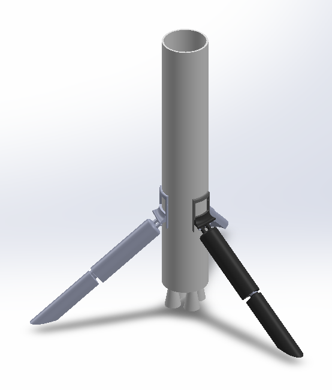
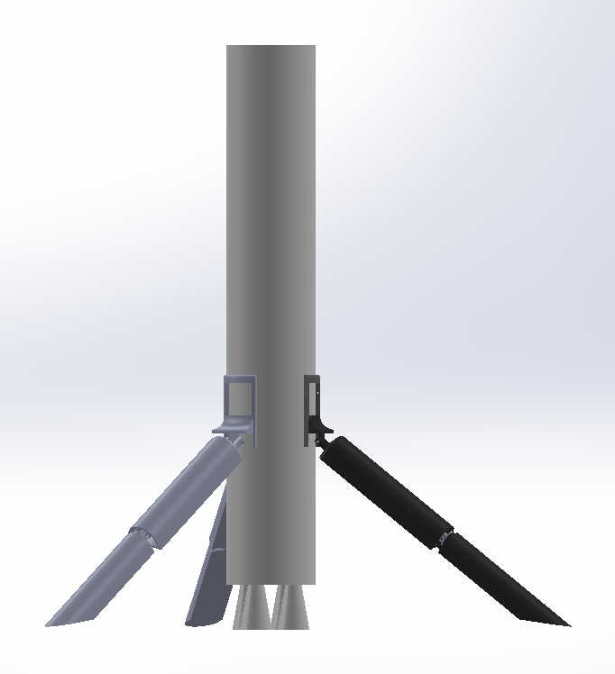
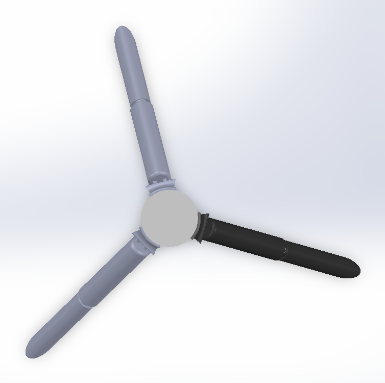
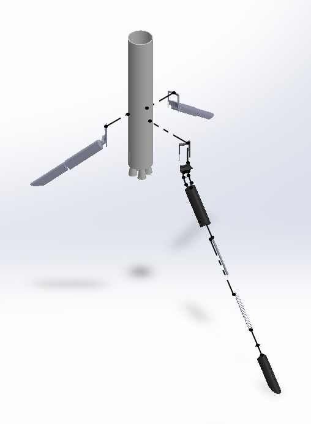

# Retractable Rocket Landing Gear

**Live project page (with interactive 3D model):** https://eeerrriiiccccc.github.io/landing-gear/
Part of my portfolio: https://eeerrriiiccccc.github.io/

A three-legged retractable landing gear for a Ø500 mm × 3 m vertical-landing rocket, designed solo in SolidWorks 2025 from concept through part modeling, mated assembly, and engineering drawings.

- **3 legs at 120°** with a deployed footprint of about 3.0 m
- **Spring-damper shock absorber in every leg** (800 mm × Ø100 mm) to absorb touchdown impact and protect the airframe
- **Mechanism modeled with mates** (concentric, symmetric, limit-distance, rack-and-pinion, linear coupler) so deployment and shock travel move in the assembly
- **9 custom parts / 28 components**, M5 counterbored bolt interfaces, ribbed thin-wall leg segments

| Front | Top (120° layout) | Exploded |
|---|---|---|
|  |  |  |

## Files
- `index.html`: the project page (static HTML, served by GitHub Pages)
- `assets/landing_gear.glb`: 3D model exported from the final SolidWorks assembly
- `assets/*.png`: views rendered in SolidWorks

Junyu Zhang · University of Washington, Electrical & Computer Engineering
